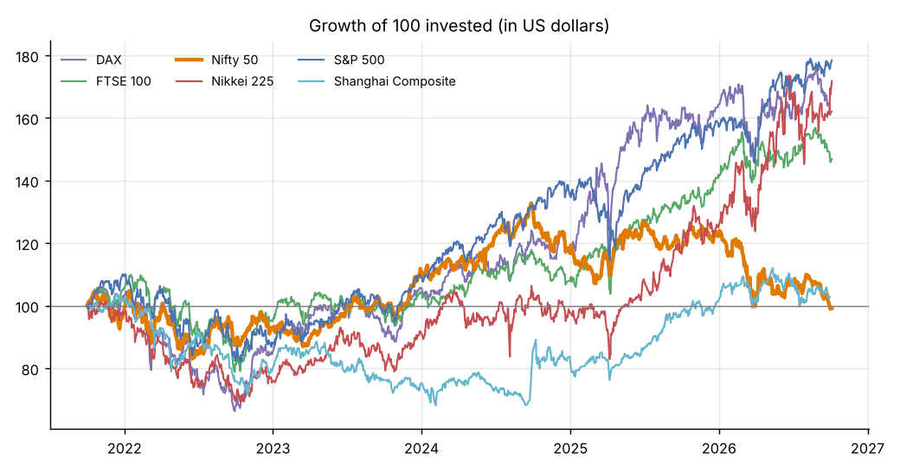
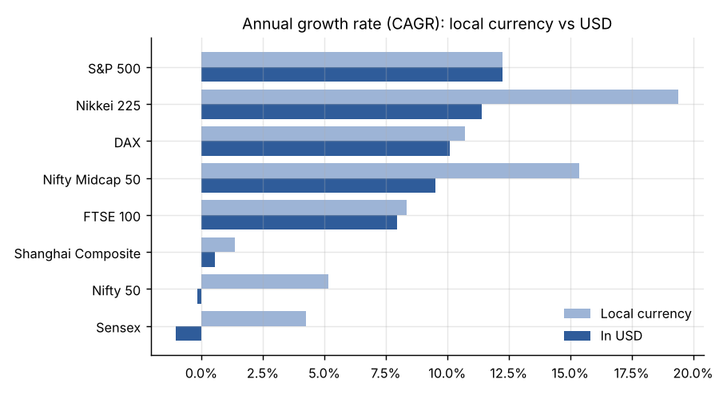
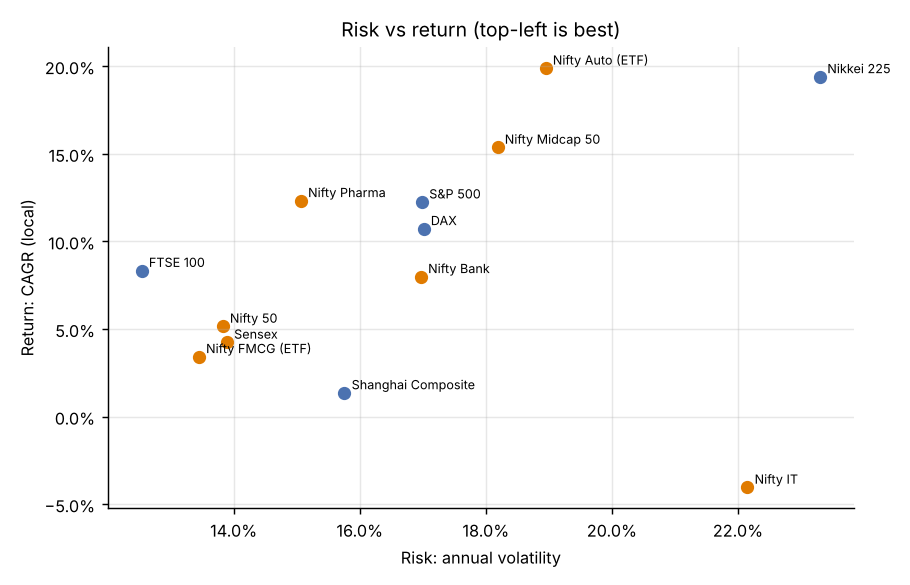
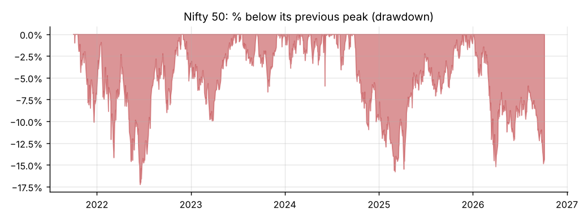
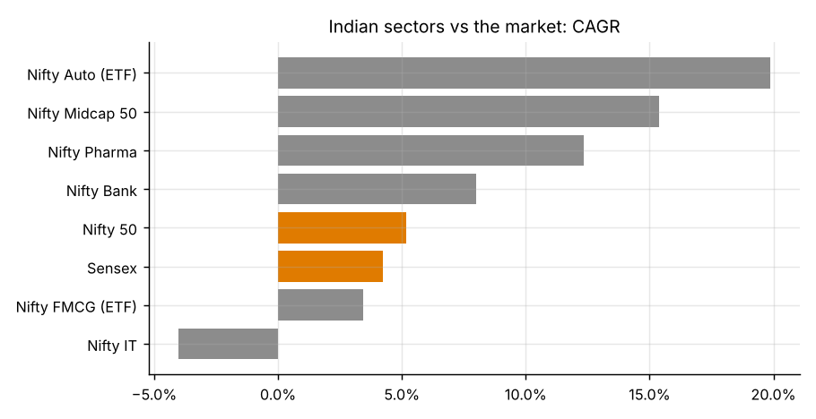
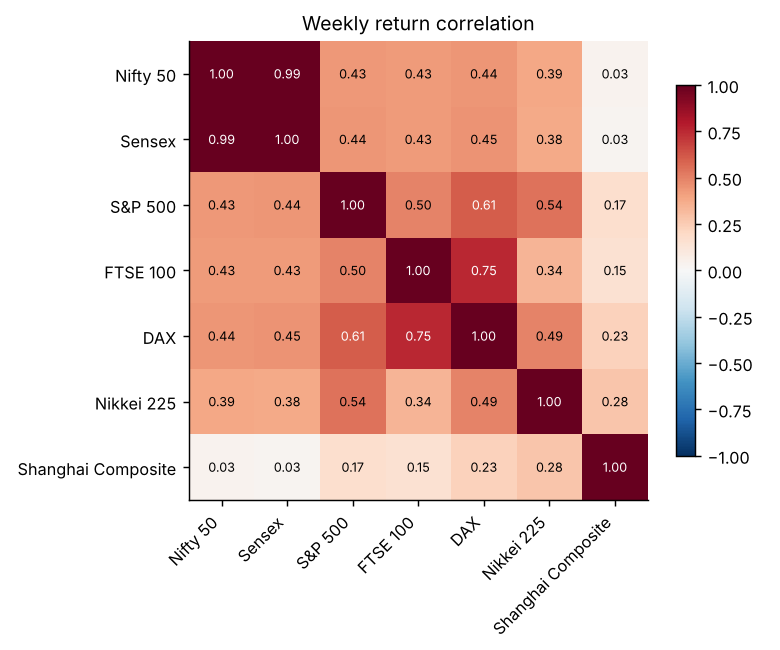
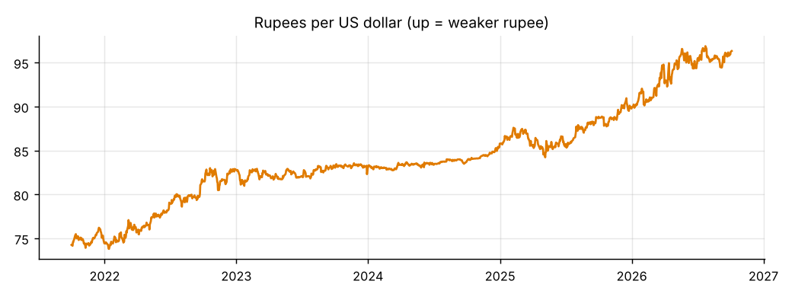
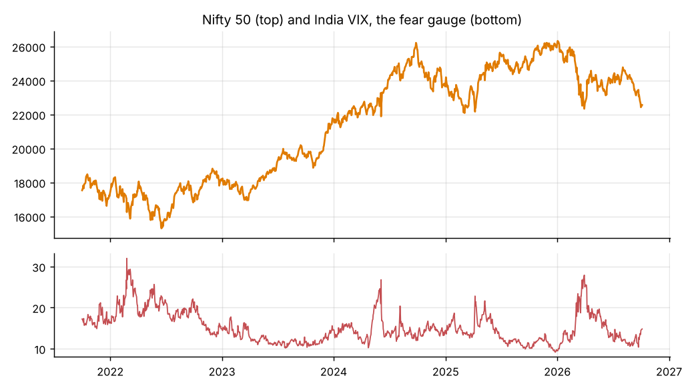
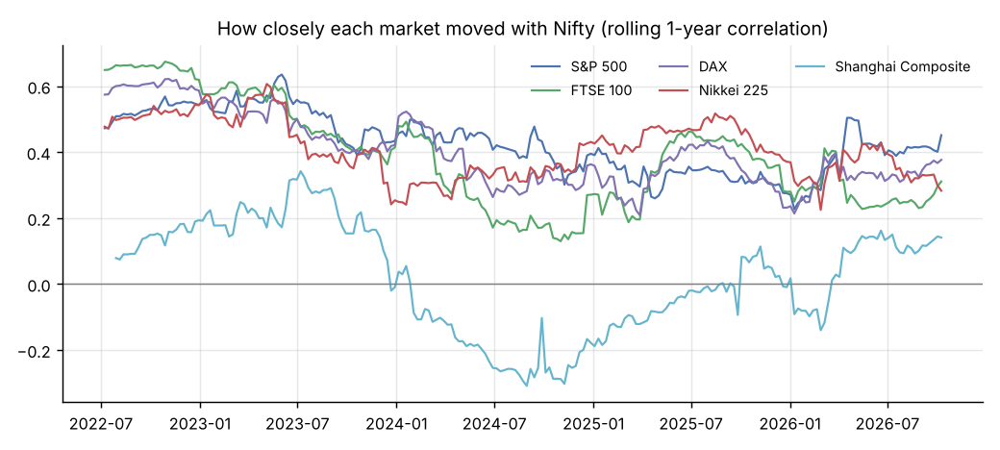
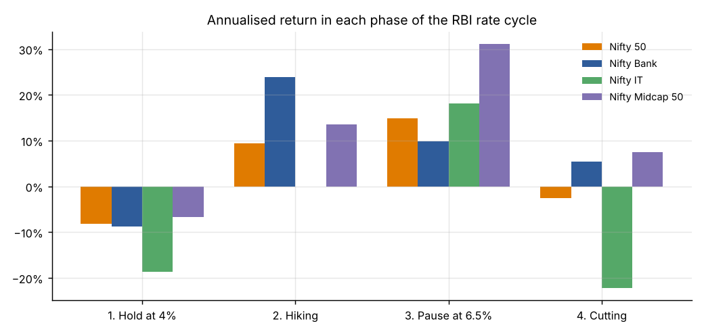

# Indian Stock Market: 5 Years in Review (Oct 2021 to Oct 2026)

How did Indian equities perform over the last five years, what drove them,
and how did they compare with the US, China, Japan, the UK and Germany?

Python (pandas, numpy, matplotlib) for the analysis, Tableau for the
dashboard. Daily data from 1 Oct 2021 to 5 Oct 2026 for 11 indices, 2 index ETFs
and 5 currencies, plus India's GDP, inflation, repo rate and foreign investor flows.

---

## Key findings

1. **Nifty 50 grew 28.7% in five years, 5.2% a year.** That is slightly
   *below* what Indian government treasury bills paid (about 6%), so investors
   got almost no reward for the extra risk (Sharpe ratio about 0).
2. **For a dollar investor, India returned nothing.** The rupee fell from
   74.3 to 96.3 per dollar (it lost 23% of its value), which wiped out the
   whole gain: Nifty's annual return in USD was -0.2%.
3. **India lagged every major market except China.** Annual growth in local
   currency: Nikkei 19.4%, S&P 500 12.3%, DAX 10.7%, FTSE 8.3%,
   Nifty 5.2%, Shanghai 1.4%.
4. **An Indian who invested abroad did much better.** ₹100 put into the
   S&P 500 in Oct 2021 is worth ₹231 today, against ₹129 in the Nifty 50,
   because the US market rose *and* the dollar strengthened.
5. **Calm but slow.** Nifty was the second-least volatile of the six markets
   (13.8% a year), and its worst fall (-17%) was far milder than the US,
   German, Japanese and Chinese ones (-25% to -27%). Low risk came with low return.
6. **The action was below the large caps.** Mid caps doubled (+105%), Auto
   (ETF, +134% since Jan 2022) and Pharma (+79%) led, while IT *lost* 19% and is
   38% below its Dec 2024 peak after AI-disruption fears hit IT services.
7. **2026 has been a bad year.** Nifty is down 13.7% year to date and 14.3%
   below its record close of 26,329 (2 Jan 2026), hit by the Iran-war oil
   shock, record foreign selling (₹2.32 lakh crore by 4 Sep) and a falling rupee.
8. **The result depends on when you measure.** Measured to the January 2026
   peak, Nifty's annual growth was 10.0%. Measured to today, 5.2%. Five years
   is a short window for equities.

---

## Charts

| | |
|---|---|
|  |  |
|  |  |
|  |  |
|  |  |
|  |  |

**Interactive dashboard:** `tableau/India_Market_Dashboard.twbx`, three pages
(India at a glance, India vs the world, Inside India) with 12 charts.
Open it in Tableau Public or Tableau Desktop; `TABLEAU_GUIDE.md` explains each
page and how the workbook is built. Live version on Tableau Public: [India Market Dashboard](https://public.tableau.com/views/India_Market_Dashboard/Indiaataglance).

---

## Findings by parameter

### 1. Returns and growth (CAGR)
*CAGR is the steady yearly growth rate that turns the start value into the end value.*

| Index | 5-yr return | CAGR (local) | CAGR (USD) | CAGR (in ₹ for an Indian investor) |
|---|---|---|---|---|
| Nikkei 225 (Japan) | +143.1% | 19.4% | 11.4% | 17.3% |
| S&P 500 (US) | +78.4% | 12.3% | 12.3% | 18.2% |
| DAX (Germany)* | +66.6% | 10.7% | 10.1% | 16.0% |
| FTSE 100 (UK) | +49.4% | 8.3% | 8.0% | 13.7% |
| **Nifty 50 (India)** | **+28.7%** | **5.2%** | **-0.2%** | **5.2%** |
| Sensex (India) | +23.2% | 4.2% | -1.0% | 4.2% |
| Shanghai Composite (China) | +7.0% | 1.4% | 0.6% | 5.7% |

\*The DAX includes reinvested dividends; the others are price-only (see Limitations).

**Conclusion:** Over these five years India was a low-growth market by global
standards. In local currency only China grew less, but in dollars the falling
rupee made India the worst of the six markets: even Shanghai made +0.6% a year,
against -0.2% for the Nifty.

### 2. Risk: volatility
*Volatility measures how much prices swing. 14% means a typical year lands
within about ±14% of the average.*

Nifty 13.8%, Sensex 13.9%, FTSE 12.5%, Shanghai 15.8%, S&P 500 17.0%,
DAX 17.0%, Nikkei 23.3%. Nifty moved more than 2% in a day on only 39 days
in five years (3% of days), against 150 days for the Nikkei. Measured in
dollars (index and currency swings together), Nifty's volatility is 15.3%,
still the second-lowest after the FTSE (15.2%).

**Conclusion:** Over this window, Indian large caps were among the least volatile
of the six markets.
Japan's high return came with almost twice India's volatility.

### 3. Worst falls: drawdowns
*A drawdown is how far the price is below its previous peak.*

| Nifty fall | Peak | Bottom | Depth | Back to peak |
|---|---|---|---|---|
| 2022 rate hikes and Ukraine war | 18 Oct 2021 | 17 Jun 2022 | -17.2% | 24 Nov 2022 |
| 2024-25 foreign selling and tariffs | 26 Sep 2024 | 4 Mar 2025 | -15.8% | 2 Jan 2026 |
| 2026 oil shock (ongoing) | 2 Jan 2026 | 30 Mar 2026 | -15.2% | not yet |
| Election-day shock | 3 Jun 2024 | 4 Jun 2024 | -5.9% | 7 Jun 2024 (3 days) |

Worst falls elsewhere: S&P 500 -25.4%, DAX -26.4%, Nikkei -26.3%,
Shanghai -26.6%. Only the FTSE 100 (-13.4%) held up better than India.

**Conclusion:** India never had a crash in this period, just three slow 15-17%
corrections. The 2024-25 one took 15 months to recover.

### 4. Risk-adjusted return: Sharpe and Sortino
*Sharpe = (return - risk-free rate) / volatility: return earned per unit of risk.*

Nikkei 0.89, S&P 500 0.56, DAX 0.56, FTSE 0.44, Shanghai 0.05,
**Nifty 0.01**, Sensex -0.06. In India, Auto (0.75), Midcap 50 (0.57) and
Pharma (0.47) scored well; IT (-0.35) and FMCG (-0.12) were negative.

Why is Nifty's Sharpe slightly positive when its CAGR (5.2%) is below the 6%
T-bill rate? The Sharpe ratio uses the *average* yearly return (average daily
return x 252, about 6.1%), which is higher than CAGR by roughly half the
variance. Measured with CAGR instead, Nifty's Sharpe would be -0.06. Either
way it is about zero.

**Conclusion:** Holding the Nifty 50 index paid about the same as a
government treasury bill, without the safety. The risk only paid off in
mid caps and the leading sectors.

### 5. Tail risk: bad days
*VaR 95% is the daily loss you exceed only 1 day in 20. CVaR is the average
loss on those worst days.*

Nifty's VaR is -1.4% and CVaR -2.0%. Its returns have negative skew (-0.37:
big down days are bigger than big up days) and fat tails (excess kurtosis 3.7).
The single worst day was 4 Jun 2024 (election results, -5.9%); the best was
12 May 2025 (after the India-Pakistan ceasefire, +3.8%).

**Conclusion:** A "normal" bell curve underestimates extreme days in every
market studied, and in India the extremes skew to the downside.

### 6. Sectors and company size
*Beta measures how much an index moves when Nifty moves 1%.*

| Index | CAGR | Volatility | Beta vs Nifty | Max fall |
|---|---|---|---|---|
| Nifty Auto (ETF, from Jan 2022) | 19.9% | 18.9% | 1.06 | -28.3% |
| Nifty Midcap 50 | 15.4% | 18.2% | 1.08 | -22.6% |
| Nifty Pharma | 12.3% | 15.1% | 0.58 | -21.7% |
| Nifty Bank | 8.0% | 17.0% | 1.07 | -20.9% |
| Nifty 50 | 5.2% | 13.8% | 1.00 | -17.2% |
| Nifty FMCG (ETF) | 3.4% | 13.4% | 0.56 | -32.4% |
| Nifty IT | -4.0% | 22.1% | 0.95 | -44.0% |

**Conclusion:** Autos (domestic demand), pharma (largely export-driven, mainly
US generics) and mid-sized companies drove India's gains. IT, which earns from global clients, fell
sharply in 2026 amid AI-disruption fears. FMCG, usually "defensive", was
the worst place to hide in 2026 (-20% this year).

### 7. Currency
The rupee weakened from 74.3 to 96.3 per US dollar (record low 96.9 on
24 Jul 2026): the dollar's price in rupees rose about 5.3% a year, and the
fall sped up in 2025-26 (from 85.8 at the end of 2024). The yen fell even more
(111 to 158 per dollar), which is why the Nikkei's 19.4% local return shrinks
to 11.4% in USD.

**Conclusion:** For foreign investors, currency moves mattered as much as the
market itself. For Indian investors, owning foreign assets would have hedged
the rupee's fall.

### 8. Links with other markets (correlation)
*Correlation runs from -1 to +1; +1 means two markets move in lockstep.*

Weekly correlation of Nifty with: S&P 500 0.43, DAX 0.44, FTSE 0.43,
Nikkei 0.39, Shanghai 0.03. The rolling 1-year correlation with the S&P 500
fell from about 0.55 in 2022-23 to 0.28 at the end of 2025, before rising
back to 0.45.

**Conclusion:** India moves only loosely with Western markets and not at all
with China, so it adds diversification to a global portfolio, though in
global shocks (Feb 2022, Apr 2025) everything still falls together.

### 9. The economy: GDP, inflation, interest rates, foreign money

| Fiscal year | Real GDP growth | CPI inflation | Nifty return |
|---|---|---|---|
| FY2022-23 | 7.6% | 6.7% | -0.6% |
| FY2023-24 | 9.2% | 5.4% | +28.6% |
| FY2024-25 | 7.1% | 4.6% | +5.3% |
| FY2025-26 | 7.7% | 1.7% (Apr-Dec) | -5.1% |

| Calendar year | Net foreign (FPI) equity flows | Nifty return |
|---|---|---|
| 2022 | -₹1.21 lakh crore | +4.3% |
| 2023 | +₹1.71 lakh crore | +20.0% |
| 2024 | about zero | +8.8% |
| 2025 | -₹1.66 lakh crore | +10.5% |
| 2026 | -₹2.32 lakh crore (to 4 Sep) | -13.7% (to 5 Oct) |

RBI rate cycle, annualised returns per phase:

| Phase | Nifty 50 | Nifty Bank |
|---|---|---|
| Hold at 4% (Oct 2021 to May 2022) | -8.1% | -8.8% |
| Hiking to 6.5% (May 2022 to Feb 2023) | +9.4% | +23.8% |
| Pause at 6.5% (Feb 2023 to Feb 2025) | +14.8% | +9.9% |
| Cutting to 5.25% (Feb 2025 to now) | -2.6% | +5.4% |

The first two phases are shorter than a year (7 and 9 months), so annualising
magnifies them. Actual returns in the hiking phase were +7.2% (Nifty) and
+17.8% (Nifty Bank).

**Conclusions:**
- Fast GDP growth did not mean high stock returns in the same year: FY26
  grew 7.7% with record-low inflation, yet Nifty fell 5%.
- Foreign flows lined up with the extremes: the one year of big foreign buying
  (2023) was the best year, and record selling in 2026 came with the worst.
  But 2025 shows the link is loose: foreigners sold ₹1.66 lakh crore and Nifty
  still rose 10.5%, as domestic investors bought. With five years this is a
  pattern, not proof.
- Rate hikes did not hurt banks: Bank Nifty rose 17.8% in the 9 months the RBI
  was hiking (about 24% annualised). A likely reason, not measured here, is
  that loan rates reset faster than deposit rates, widening lending margins.
  Rate cuts did not lift the market either; the cutting phase coincided with
  US tariffs, record foreign selling and the oil shock.

### 10. Fear gauge: India VIX
*India VIX estimates how much traders expect Nifty to move over the next 30 days.*

Average 15.1. Highest 32.0 on 24 Feb 2022 (Ukraine invasion); lowest 9.2 on
26 Dec 2025, one week before Nifty's all-time high and the 2026 fall. Daily
VIX changes and Nifty returns have a correlation of -0.62. On the most fearful
10% of days (VIX above 20.4), Nifty's next 3 months averaged +3.6%, versus
+1.6% on other days.

**Conclusion:** Fear and falls go together, and very low fear (complacency)
came just before the 2026 correction. Buying when fear was high worked in
this sample, but it is too small to treat as a rule.

### 11. Key events and how the market reacted (same day)

| Date | Event | Market move |
|---|---|---|
| 24 Feb 2022 | Russia invades Ukraine | Nifty -4.8% |
| 4 Jun 2024 | General election results | Nifty -5.9% (worst day) |
| 5 Aug 2024 | Yen carry-trade unwind | Nikkei -12.4%, Nifty -2.7% |
| 24 Sep 2024 | China stimulus | Shanghai +4.2% |
| 7 Apr 2025 | Global tariff sell-off | Nifty -3.2% |
| 9 Apr 2025 | US pauses tariffs | S&P 500 +9.5% |
| 12 May 2025 | India-Pakistan ceasefire | Nifty +3.8% (best day) |
| 4 Feb 2026 | Anthropic's Claude Cowork plugins spark AI-disruption fears | Nifty IT -5.9% (its worst day in six years) |
| 24 Feb 2026 | More AI fears (Anthropic's legacy-code claims) | Nifty IT -4.7% |
| 8 Apr 2026 | US-Iran ceasefire | Nifty +3.8% |

Full list with 24 events: `output/market_events.csv`.

### 12. Seasonality
Nifty fell in January in all five years (average -1.2%) and rose in July in
four of five (average +3.0%). **Treat this as noise:** with only five years
per month, there is roughly a 54% chance that at least one of the 12 months
shows a perfect 5-out-of-5 pattern purely by luck.

---

## Method

1. **Data:** daily closing prices from Yahoo Finance (`yfinance`), 1 Oct 2021
   to 5 Oct 2026. Yahoo has no data for the Nifty Auto and FMCG indices, so
   ETFs that track them stand in (AUTOBEES from Jan 2022, FMCGIETF).
2. **Cleaning:** removed missing and zero prices and duplicates, and aligned
   each market on its own trading days. Currency rates are matched "as of" each
   date. Checks: no gaps longer than a holiday, and the biggest daily index
   moves all match real events; Nifty's calendar-year returns match published
   figures. Five one-day bad ticks in the currency data (a 1.5-2.3% jump that
   reverses the next day, e.g. INR 83.28 -> 85.19 -> 83.25 on 2 Nov 2023) are
   removed and replaced by the previous day's rate. They only affected the daily
   dollar lines, not any CAGR.
3. **Metrics:** returns, CAGR (local, USD, INR), volatility, Sharpe, Sortino,
   drawdowns, beta, VaR/CVaR, skew, kurtosis, weekly correlations, rolling
   1-year metrics.
4. **Macro:** GDP, CPI, repo rate and FPI flows entered from official
   releases, each with its source in the CSV.
5. **Deep dives:** rolling 1-year return and risk, tail risk, India VIX, the RBI
   rate cycle, fiscal years against GDP, seasonality, and 24 events checked
   against the data.

## Limitations
- **Dividends:** most indices here are price-only. Adding dividends would lift
  Nifty to roughly 6.5% a year and help the FTSE (high dividends) most. The
  DAX already includes dividends, and the ETF stand-ins include them minus fees.
- **Window:** five years with the end date inside a correction; results change
  a lot with the start and end dates (see finding 8).
- **Not covered:** valuations (P/E), company earnings and domestic fund flows.
- **Macro data:** India rebased GDP (2022-23 base) and CPI in 2026, so older and
  newer years come from slightly different series. 2025 and 2026 FPI figures are
  rounded news-report numbers.
- **Risk-free rates** for the Sharpe ratio are approximate period averages.

## Data sources
- Prices: Yahoo Finance via the `yfinance` Python library.
- GDP: [MoSPI provisional estimates, 5 Jun 2026](https://www.pib.gov.in/PressReleasePage.aspx?PRID=2269286&reg=48&lang=2).
- Inflation: [Economic Survey 2025-26](https://www.pib.gov.in/PressReleasePage.aspx?PRID=2220004&reg=3&lang=1), [CPI history](https://rupaywise.com/data/inflation-history).
- Repo rate: [RBI decisions summary](https://indiainflation.com/rbi/repo-rate).
- FPI flows: NSDL data via [Upstox](https://upstox.com/news/market-news/stocks/fii-outflows-2025-the-worst-year-for-foreign-investment-as-overseas-investors-sell-shares-worth-over-1-5-lakh-crore/article-186114/) and [Free Press Journal](https://www.freepressjournal.in/business/fpis-dump-rs-7443-crore-in-september-first-week-2026-equity-exodus-hits-rs-232-lakh-crore).
- 2026 events: [Upstox market wrap, 8 Apr 2026](https://upstox.com/news/market-news/stocks/market-wrap-april-8-indices-jump-4-sensex-posts-biggest-single-day-gain-in-6-years-nifty-50-at-23-997-level-vix-tanks-20/article-191861/), [2026 Iran war fuel crisis](https://en.wikipedia.org/wiki/2026_Iran_war_fuel_crisis), [Nifty IT fall on AI fears](https://www.tradingview.com/news/moneycontrol:69674666d094b:0-nifty-it-index-crashes-over-5-as-anthropic-s-ai-claims-fuel-disruption-fears-tcs-infosys-among-top-losers/), [IBM and Indian IT, 24 Feb 2026](https://www.technology.org/2026/02/24/ibm-loses-30-billion-ai-learned-65-year-old-programming-language/), [Why Nifty is falling in 2026](https://anandrathi.com/blog/why-nifty-is-falling).

## How to run
```
pip install -r requirements.txt
cd scripts
python 01_download_data.py      # main indices and currencies -> data/raw_prices.csv
python 01b_download_extra.py    # ETF stand-ins, Midcap 50, India VIX -> data/raw_prices_extra.csv
python run_all.py               # analysis, macro, deep dives, charts, Tableau workbook
```

## Project structure
```
scripts/           01/01b download · 02 analysis · 04 charts · 05 macro · 06 deep dives
                   · 07 Tableau workbook · config
data/              raw downloaded prices
output/            21 tidy CSVs (20 from the analysis, 1 reshaped for Tableau)
charts/            10 PNG charts used above
tableau/           India_Market_Dashboard.twbx, the Tableau dashboard (see TABLEAU_GUIDE.md)
```
